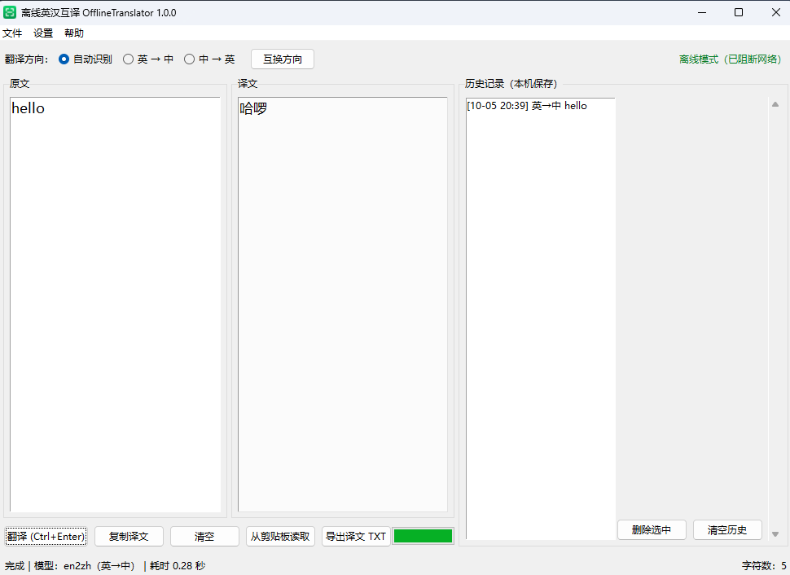

# OfflineTranslator

**A fully offline English ↔ Chinese translator for Windows. Your text never leaves the machine — the program contains no network code at all.**


English · [中文说明](README.zh-CN.md)



Python + tkinter on top of [Argos Translate](https://github.com/argosopentech/argos-translate)
(CTranslate2 + SentencePiece). Two bundled models translate both directions without a
single network request.

---

## Privacy by construction

Not "we promise we don't collect anything" — there is no code that could:

| | |
| --- | --- |
| **No network code** | No `socket`, `urllib`, `requests`, `http.client` in the application. |
| **Sockets blocked at runtime** | The program blocks its own process's sockets at startup, so even a third-party library cannot phone home. |
| **Argos cannot fetch** | `ARGOS_PACKAGE_INDEX` is pointed at a dead local address (`http://127.0.0.1/offline-no-package-index/`), so Argos' own "update models" path cannot work. |
| **One writable directory** | `%APPDATA%\OfflineTranslator` — settings, history, log. Nothing else is written. |
| **No telemetry, no updater** | No crash reporting, no analytics, no auto-update. |

The window title bar shows **「离线模式（已阻断网络）」** while it is running.

## Features

| | |
| --- | --- |
| **Auto translate** | Type or paste, pause ~0.8 s, the translation appears. Adjustable 200–3000 ms. |
| **Auto direction** | Chinese input → English, English input → Chinese. Manual override available. |
| **Long text** | Over 500 characters it splits into sentences, translates on a worker thread, and shows "sentence n/m" progress. |
| **Stale-result protection** | Every request carries a sequence number; results from older input are discarded, so the text never "jumps" while you type. |
| **History** | Last N entries (default 200) stored locally, click to reuse, delete one or clear all. |
| **Clipboard / export** | Read from clipboard, copy translation, export as `.txt`. |
| **Shortcuts** | `Ctrl+Enter` translate, `Ctrl+Shift+S` swap direction, `Ctrl+Shift+T` always on top. |

## Install

Requires Windows 10/11 and Python 3.13 (3.12 should work; 3.13 is what is tested).

```powershell
pip install --no-deps -r requirements.txt
```

**`--no-deps` matters.** `argostranslate` declares `spacy` and `stanza` as dependencies, and
`stanza` pulls in **torch (~1 GB)**. This project does not use either: sentence splitting is
done by its own implementation (`OfflineSentencizer` in `src/translator.py`), which is also
why the packaged build is ~300 MB instead of ~420 MB. Installing with `--no-deps` gives a
**107 MB** environment with exactly the twelve packages that are actually used.

### Models

The two models (~164 MB) are **not** in this repository. See
[models/README.md](models/README.md) for three ways to obtain them, or grab them from the
[Releases](https://github.com/GEEK-ikun/OfflineTranslator/releases) page:

```
models/packages/translate-en_zh-1_9/
models/packages/translate-zh_en-1_9/
```

## Run

```powershell
python src\main.py
```

## Build the installer

```powershell
powershell -NoProfile -ExecutionPolicy Bypass -File .\build_tools\build.ps1
```

Then either Inno Setup (`build_tools\installer.iss`, needs ISCC) or the self-extracting
fallback (`build_tools\make_sfx_installer.ps1`).

## How the "offline" part actually works

`src/argos_env.py` must run **before** `import argostranslate`, because Argos 1.11 creates
`~/.local/share/argos-translate` and friends at import time. The module:

1. redirects `XDG_*` and `ARGOS_*` into the app's own data directory,
2. points `ARGOS_PACKAGES_DIR` at the bundled `models/packages`,
3. points the package index at a dead address so nothing can be downloaded,
4. sets `ARGOS_CHUNK_TYPE=ARGOSTRANSLATE` so Argos does not reach for stanza.

`src/translator.py` additionally installs a stub `stanza` module before importing Argos,
which is what makes the dependency set so small.

## Verification

| What | Result |
| --- | --- |
| `build_tools/test_translator.py` — sentence, long text, edge cases, direction, 200-sentence stress | pass |
| Clean-environment install with `--no-deps` | 12 packages, 107 MB, no torch / spacy / stanza |
| Translation after that install | both directions work |

The first screenshot in this README was taken from the running application; the text shown
is a test sentence.

## License

- **Code:** MIT — see [LICENSE](LICENSE).
- **Models:** CC-BY-4.0, by [Argos Open Tech](https://www.argosopentech.com/), trained on
  OPUS data. Redistribution requires attribution — see
  [assets/LICENSE-THIRD-PARTY.md](assets/LICENSE-THIRD-PARTY.md).
- **Icon:** drawn by `build_tools/make_icon.py`, no third-party artwork.
