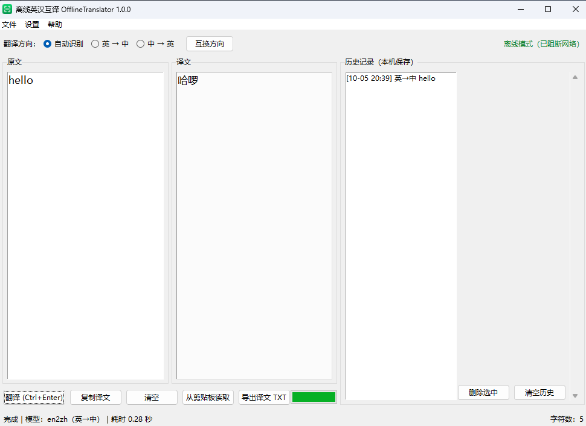

# 离线英汉互译 · OfflineTranslator

**完全离线的英汉 / 汉英双向翻译桌面软件。你的文字不会离开这台电脑——程序里根本没有网络代码。**


[English](README.md) · 中文



Python + tkinter，翻译引擎是 [Argos Translate](https://github.com/argosopentech/argos-translate)
（CTranslate2 + SentencePiece）。两个模型随软件分发，双向翻译全程零网络请求。

---

## 隐私：不是承诺，是结构

这不是"我们保证不收集"——是**没有能收集的代码**：

| | |
| --- | --- |
| **没有网络代码** | 程序里没有 `socket`、`urllib`、`requests`、`http.client`。 |
| **运行期阻断 socket** | 启动即封掉本进程的网络能力，连第三方库也发不出去。 |
| **Argos 也下载不了** | `ARGOS_PACKAGE_INDEX` 被指向一个不存在的本地地址（`http://127.0.0.1/offline-no-package-index/`），Argos 自带的"更新模型"路径不可能工作。 |
| **只写一个目录** | `%APPDATA%\OfflineTranslator`——设置、历史、日志，别的一概不写。 |
| **无遥测、无自动更新** | 没有崩溃上报、没有统计、没有更新检查。 |

运行期间窗口标题栏会显示 **「离线模式（已阻断网络）」**。

## 功能

| | |
| --- | --- |
| **自动翻译** | 输入或粘贴后停顿约 0.8 秒自动出结果，等待时长可调（200–3000 ms）。 |
| **自动识别方向** | 输入中文译英，输入英文译中；也可以手动锁定方向。 |
| **长文本** | 超过 500 字符自动分句，后台线程翻译，界面显示「第 n/m 句」。 |
| **时序保护** | 每次请求带自增序号，过期结果直接丢弃，连续输入时译文不会乱跳。 |
| **历史记录** | 本机保存最近 N 条（默认 200），点击回填，可单条删除或一键清空。 |
| **剪贴板 / 导出** | 从剪贴板读取、复制译文、导出 `.txt`。 |
| **快捷键** | `Ctrl+Enter` 翻译、`Ctrl+Shift+S` 互换方向、`Ctrl+Shift+T` 窗口置顶。 |

## 安装

需要 Windows 10/11 和 Python 3.13（3.12 应该也可以，3.13 是实测版本）。

```powershell
pip install --no-deps -r requirements.txt
```

**`--no-deps` 不能省。** `argostranslate` 声明了 `spacy` 和 `stanza` 两个依赖，而
`stanza` 会把 **torch（约 1 GB）** 拉进来。本项目两个都不用：分句由自己实现的
`OfflineSentencizer`（见 `src/translator.py`）完成，这也是打包体积能压在约 300 MB
而不是 420 MB 的原因。用 `--no-deps` 装出来的环境是 **107 MB**，正好是实际用到的
12 个包。

### 模型

两个模型（约 164 MB）**不在仓库里**。获取方式见 [models/README.md](models/README.md)，
也可以直接从 [Releases](https://github.com/GEEK-ikun/OfflineTranslator/releases) 下载：

```
models/packages/translate-en_zh-1_9/
models/packages/translate-zh_en-1_9/
```

## 运行

```powershell
python src\main.py
```

## 打包

```powershell
powershell -NoProfile -ExecutionPolicy Bypass -File .\build_tools\build.ps1
```

然后二选一：Inno Setup（`build_tools\installer.iss`，需要 ISCC）或自解压兜底脚本
（`build_tools\make_sfx_installer.ps1`）。

## 「离线」到底是怎么做到的

`src/argos_env.py` 必须在 `import argostranslate` **之前**跑完，因为 Argos 1.11 在 import
阶段就会去创建 `~/.local/share/argos-translate` 这些目录。这个模块做了四件事：

1. 把 `XDG_*`、`ARGOS_*` 全部收敛到软件自己的数据目录；
2. 把 `ARGOS_PACKAGES_DIR` 指向自带的 `models/packages`；
3. 把包索引指向一个不存在的地址，从根上断掉下载；
4. 设 `ARGOS_CHUNK_TYPE=ARGOSTRANSLATE`，让 Argos 不去找 stanza。

`src/translator.py` 还会在 import Argos 之前塞一个 stanza 占位模块——这就是依赖能压到 12 个包的原因。

## 验证记录

| 项目 | 结果 |
| --- | --- |
| `build_tools/test_translator.py`：逐句、长文本、边界、方向、200 句压力 | 通过 |
| 干净环境用 `--no-deps` 安装 | 12 个包、107 MB，无 torch / spacy / stanza |
| 装完之后实际翻译 | 中英双向正常 |

README 顶部那张截图取自运行中的程序，里面的文字是测试句子。

## 许可

- **代码**：MIT —— 见 [LICENSE](LICENSE)。
- **模型**：CC-BY-4.0，由 [Argos Open Tech](https://www.argosopentech.com/) 提供，
  训练数据来自 OPUS。再分发必须保留署名——见
  [assets/LICENSE-THIRD-PARTY.md](assets/LICENSE-THIRD-PARTY.md)。
- **图标**：由 `build_tools/make_icon.py` 自行绘制，无第三方素材。
